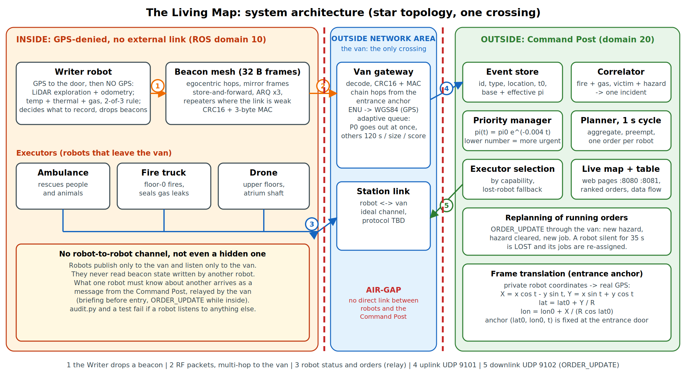

# The Living Map: spatial memory for emergency robots (IEEE TSYP14, Fire / Hazardous Building)

A **Writer** robot explores a GPS-denied, two-floor burning building and drops 32-byte radio beacons. A **van** (Outside Network Area) is the only link between inside and outside: it decodes the beacons, converts their private coordinates to GPS and forwards them to the **Command Post**, which ranks the events, groups related ones into single orders and briefs the **Executor** robots (ambulance, fire truck, drone). Robots never talk to each other or to the Command Post directly.



## Run it (Ubuntu 24.04, ROS 2 Jazzy)
```bash
cd ~/living_map_ws && source /opt/ros/jazzy/setup.bash && colcon build --symlink-install
bash src/living_map_core/scripts/run_clean.sh speed:=6 2>&1 | tee ~/launch.log      # then open the three pages below
bash src/living_map_core/scripts/check_run.sh                                       # after about 60 s
```
Pages: `http://localhost:8081` simulation, `http://localhost:8080` Command Post, `http://localhost:8081/flow` data flow and beacon table.
Without ROS: `cd src/living_map_core && python3 -m living_map_core.standalone --speed 6` (add `--map maps/proto_arena.json` for the 7.2 x 4.8 m prototype arena).
Tests: `python3 -m pytest test/test_core.py -q` (39 tests, about 2 minutes).

## Results (simulation, 5 seeds, `python3 tools/collect_results.py`)
| measure | value |
|---|---|
| Executor time to a person, from leaving the van | **40 s** vs **270 s** for the same robot searching blind |
| end to end (Writer drives to the door by GPS, explores, briefing, Executor), first person reached | **411 s** (the Writer finds the first reachable person after 363 s and finishes exploring after 525 s) |
| whole mission | about 575 s: 4/4 fires out, 4/5 people rescued (the 5th is sealed behind rubble and flagged for human rescue) |
| beacons delivered | 195/201 (97 %) |
| position error | 0.31 m mean |
| uplink | immediate: 40 messages; batched: 11 (-72 %), class P1 delayed 27 s on average |
| radio attenuation stress | fires out 4/4 at 12 dB per wall, 3/4 at 18, 1/4 at 24, 0/4 at 30: **the design fails under very strong attenuation** |
| prototype arena (7.2 x 4.8 m, 5 seeds) | fire out, 3/4 rescued, all beacons delivered; steam rejected on 5/5, debris beacon on 3/5 seeds |

Read the two first rows together: the chain does not make the *first* arrival earlier end to end (the Writer must explore first); it removes blind searching inside the hazard, lets one Writer pass serve every Executor, and handles the whole building.

## Where to read more
| File | Content |
|---|---|
| `src/living_map_core/docs/Living_Map_Technical_Report.pdf` | the Phase 1 technical report |
| `REPOSITORY_GUIDE.md` | **architecture and the content of every file** |
| `src/living_map_core/docs/ARCHITECTURE.md` | modules, ROS graph, message schemas |
| `src/living_map_core/docs/FAILURE_CASES.md` | five failure cases with measured results |
| `src/living_map_core/docs/PHASE2_IMPLEMENTATION_PLAN.md` | timeline, bill of materials, physical test protocol |
| `src/living_map_core/docs/PROTOTYPE_ARENA.md` | the plywood prototype arena and the specification check |
| `src/living_map_core/docs/VIDEO_SCRIPT.md`, `SUBMISSION_CHECKLIST.md` | demo video and submission |
| `TROUBLESHOOTING.md` | when something does not start |

## Limits (read before you trust a number)
All results are from the simulator. The Gazebo world is generated from the same map and was validated only as XML; RViz and real DDS timing are not measured here. Radio loss, sensor noise and the anchor uncertainty are assumed values. The robot-to-van link is an ideal channel (protocol TBD).

---

## Details and version notes
# The Living Map v4 - multi-floor, multi-robot emergency response (IEEE TSYP14)

A Writer robot explores an unknown, GPS-denied, two-floor burning building using only its sensors and drops 32-byte beacons.
The **van** (Outside Network Area) receives them, the Command Post ranks them, and three responders leave the van:
an **ambulance robot** (rescue), a **fire-truck robot** (ground-floor fires) and a **drone** (upper-floor fires, through stairs/atrium).

## Run it
    # no ROS needed, two web pages:  http://localhost:8081 (simulation)   http://localhost:8080 (Command Post)
    cd src/living_map_core && python3 -m living_map_core.standalone [--map maps/complex.json] [--fault beacon_destroyed|writer_lost] [--speed 6]
    # full ROS 2 Jazzy (+ Gazebo Harmonic + RViz)
    colcon build --symlink-install && source install/setup.bash
    ros2 launch living_map_core living_map_fire_env.launch.py [map:=/path/map.json] [roles:=ambulance,firetruck,drone] [fault:=...] [gazebo:=false] [rviz:=false] [speed:=3.0]
    # tests
    cd src/living_map_core && python3 -m pytest test -q ; python3 test/fake_ros_integration.py ; python3 -m living_map_core.offline   (fault_tests = 3 scenarios)

## Key ideas
* **Map is data, not code.** `maps/complex.json` (generated by `tools/make_map.py`). Robots never read it: they only get LiDAR, temperature, gas and thermal-camera readings. Edit/replace the file (or `map:=`) to change the building. Legend: `. # R S A` = floor, wall/furniture, rubble, stairs, atrium shaft (drone only).
* **Egocentric beacons (no GPS inside).** "I am 4.4 m ahead, 2.1 m left of the entrance; the victim is 2.7 m ahead, 5.1 m right of me; floor 1." Heading, floor and two (ahead,right) offsets in decimetres; absolute positions are rebuilt by chaining hops (error ~0.3 m). The chain is a walkable route: floors change only at STAIRS beacons.
* **Star topology.** Robots talk only to the van (`StationLink`: STATUS, FIRE_OUT, RESCUED, RETURNED, LOW_BATTERY, ARRIVED, UNREACHABLE). No robot-robot channel exists (the auditor checks it). **The real radio protocol for robot<->van is TO BE SPECIFIED**; it is an ideal channel for now.
* **Command Post allocation.** ambulance -> people/animals (waits in the van while a fire next to its victim is burning, 150 s timeout); fire truck -> floor-0 fires; drone -> upper-floor fires. Fire next to a P0 person escalates immediately. Robots that return can be sent again (multi-sortie). Jobs that are unreachable twice are dropped.
* **Beacons get a robot close, sensors finish the job** (terminal guidance). Unknown space may only be crossed inside a band around the inherited beacon trail (4 m, widening to 16 m if needed).

## Data-flow page and beacon states (new)
Open **http://localhost:8081/flow**: an animated pipeline (Writer -> beacon mesh -> van -> Command Post -> briefing -> Executors, Executors -> van -> Command Post, Executors -> beacon) with a live message stream, and a **beacon table** updated 3x per second: every beacon, its priority, its state *at the Command Post* and its state *written on the beacon itself*.
States: KNOWN, QUEUED, HOLDING, EN_ROUTE, ON_SITE, IN_PROGRESS, RESOLVED, UNREACHABLE, HEAVY_RESCUE, LOST, ACTIVE (+ DROPPED / DESTROYED on the beacon).
**Executors update beacons.** On arrival, while working and when finished, an Executor (1) rewrites the mutable STATE byte of that beacon by short-range RF (only works within radio range; the signed 32-byte report is never altered) and (2) reports the change to the van (`BEACON_UPDATE`), which forwards it to the Command Post. The two columns can differ for a moment: that gap is the data-flow latency. ROS topics: `/beacon_write` (robot -> beacon), `/beacon_state` (beacon memory), `/sim/*` monitoring. RViz labels show `TYPE #id Pn [STATE]` and resolved beacons get a green halo.

## Measured results (simulation, default map)
Executor reaches a person 39 s after leaving the van vs 270 s searching blind (END TO END, including the Writer's exploration, the first person is reached after 408 s); 4/4 fires out, 4/5 people rescued (1 sealed behind rubble -> human heavy-rescue flag); position error ~0.3 m avg; 200/204 beacons delivered over 5 seeds; `beacon_destroyed` heals and completes; `writer_lost` (420 s) still gets 2 fires out, 3 rescued.

## Honest status
Pure-Python core, standalone web mode: tested (16 pytest tests). ROS nodes: tested only with a fake rclpy (`test/fake_ros_integration.py`): topic logic, star topology, UDP, HTTP. **Not tested here: real DDS, Gazebo (SDF is well-formed XML, 244 models, never loaded in gz), RViz.** Assumed constants (RF path loss, wall losses, sensor noise) are simulation assumptions, not measurements.

## Phase 2 notes (BOM impact)
~40 cheap beacon/relay nodes per building (LoRa/UWB class), one scout robot, three responders (tracked ambulance, wheeled fire truck, drone), a van with antenna + gateway. Robot<->van radio protocol and drone payload/battery limits still to specify.

## v4_7 additions
* Gas leaks are treated, not only avoided: GAS beacons, `World.secure()`, sealing by the fire truck / drone, joint orders (fire + gas, victim + hazard), gas cloud shrinks/disappears in the sim page, RViz and Gazebo.
* Continuous priority pi (0 = most urgent, no upper limit, drops while an event waits).
* Tests: 23 pytest tests + `test/fake_ros_integration.py` (PASS). Real DDS, Gazebo and RViz are still NOT tested by the author.

## v4_8 fix (found from a real run on Ubuntu 24.04 / ROS 2 Jazzy)
* ROOT CAUSE of "the Executors stop after one job": `LogMixin.slog()` called `getattr(logger, level)(...)` from ONE line with different severities. Real rclpy raises `ValueError: Logger severity cannot be changed between calls` the second time. In the van's `on_station()` the log came BEFORE forwarding the robot's status to the Command Post, so ARRIVED / FIRE_OUT / RESCUED / RETURNED / BEACON_UPDATE and the heartbeat were dropped.
* Fix: one call site per severity in `slog()`, and the van forwards first, logs after.
* The fake rclpy in `test/fake_ros_integration.py` now enforces the same rule, so this class of bug fails the test.
* `check_run.sh`: the Writer test no longer gives a false FAIL (it also shows the last heartbeat).

## v4_9: coordination rules (the Command Post is the only bridge)
1. **No robot-to-robot link, not even a hidden one.** Robots publish only to the van (`/station/from/<role>`) and listen only to the van (`/station/to/<role>`). They no longer read the state other robots wrote into beacons (`/beacon_state` is forbidden by `audit.py` and the test). "Hazard cleared" reaches the ambulance as an `ORDER_UPDATE`: robot -> van -> Command Post -> (UDP downlink 9102) -> van -> ambulance.
   Robot -> beacon writes remain (the beacon is a field memory, nobody reads it back); `/world/action` is the simulator's physics, not a communication channel.
2. **Event store.** `CommandPost.events()` returns for every event: `event_id, type, location, detected_at, priority_base, priority (effective), required_capabilities, status, assigned_robot, related_events, incident`.
3. **Priority, 0 -> +inf, lower = more urgent.** `pi(t) = pi_base * exp(-0.004 * age)`, `age = now - detection time` (half-life 173 s). Why: it is >= 0, tends to 0 for old events, never negative, order-preserving, and repeated reports of the same beacon do not reset it (age is counted from `t0`). A hazard in the same incident as a victim inherits 0.9 x the victim's urgency.
4. **Decision cycle** (`cycle:=1.0`): the Command Post decides once per cycle, never per event: refresh priorities -> correlate -> robot health -> replan running orders -> for each idle robot wait until the reports of the window are in -> ONE order per robot.
5. **Correlation into incidents.** Two events are related if at least one is a hazard, same floor, <= 8 m, detections <= 300 s apart; grouping is transitive (fire~gas, gas~person => one incident). Two nearby victims are NOT related; the same place on another floor is NOT related.
6. **One order for related jobs:** victim in a danger zone (ambulance order carries `wait_for` the hazard, the hazard robot leaves in the same decision); fire + gas (one robot, one order).
7. **Preemption** (`crit:=0.3`): if a job's effective pi < crit it skips the collection wait. Balance: urgent = fast, everything else is aggregated; new jobs for a robot that is already out are sent as rate-limited `ORDER_UPDATE`s (5 s) instead of new orders.
8. **Replanning / failures:** `ORDER_UPDATE` = `{targets, hazards, wait_for, cleared}`. A robot silent for 35 s (heartbeat every 10 s) is marked LOST; its jobs go to another capable robot (floor-0 fire: fire truck -> drone). It returns to service when it talks again. Duplicate reports: only a newer `seq` replaces a record.
9. New launch arguments: `cycle:=1.0`, `crit:=0.3`. New UDP port: 9102 (van downlink).

Tested: 33 pytest tests, the in-process mission (Executor search time 39.1 s vs 269.5 s blind, end to end 408 s, 4/4 fires out, 4/5 rescued) and the fake-ROS integration (PASS, 13 order updates relayed). NOT tested by the author: real DDS, Gazebo, RViz.

## v4_10: Executor navigation (`nav:=direct`, default; `nav:=trail` = old behaviour)
Before: the Executor went to every Writer waypoint in order and could cross unknown space only within 4 m of that trail, so it inherited the Writer's wandering.
Now (`roles.py`, `sim_core.plan`):
1. **A\* straight to the target** (octile heuristic; same optimal cost as the old Dijkstra, tested). The Writer's trail is only a *hint*: unknown cells are crossable anywhere (free-space assumption) but cost +0.6 per cell away from the trail, so the known-safe route is preferred when it is not much longer.
2. **Replanning from the robot's own LiDAR**: when it sees a wall or rubble on the next cells of its path it replans (the robot never reads the world file).
3. **Stairs/floors**: with a floor change in the chain it plans to the stairs entry (last waypoint on its floor), skipping trail waypoints it does not need to pass.
4. **Job order** (`Responder.order_jobs`): for one robot with several jobs, minimise the urgency-weighted completion time `sum (1/pi_i) * T_i` (travel + 15 s work + floor-change penalty), exact for <= 7 jobs: urgent jobs go first, unless a cheap job lies on the way. The Command Post's order is kept for more than 7 jobs. New jobs from an ORDER_UPDATE are inserted in the pending tail the same way.

Measured in the simulation (`python3 tools/bench_nav.py 7 3 11 1 2 5 9 13`; same maps and seeds, only the navigation differs; outcomes identical: 4/4 fires out, 4/5 people rescued, 0 failed missions):

| over 8 seeds (mean) | trail (old) | direct (new) |
|---|---|---|
| Executor time to the first person (from leaving the van) | 70.6 s (median 50 s) | 39.3 s (median 39 s) |
| total robot distance | 841 m | 773 m (-8 %) |
| total robot busy time | 700 s | 582 s (-17 %) |
| mission end | 632 s | 576 s |

Honest notes: in 2 of 8 seeds the new method drove slightly MORE distance (+6.0 %, +7.2 %). The old-method number includes the new A* planner, so the gain shown comes from the navigation and job ordering, not from the faster search. All of this is simulation; the Gazebo world and real DDS were not run by the author.

## v4_11: prototype arena (7.2 x 4.8 m) for the physical Phase 2 test
`tools/make_proto_arena.py` writes `maps/proto_arena.json` (simulator), `worlds/proto_arena.sdf` (Gazebo), `docs/proto_arena_plan.svg|png` and `docs/proto_arena_materials.md` (8 plywood sheets). Read `docs/PROTOTYPE_ARENA.md` (specification check, research, build guide, sources).
Run: `python3 -m living_map_core.standalone --speed 6 --map maps/proto_arena.json` or `run_clean.sh speed:=6 map:=$HOME/living_map_ws/src/living_map_core/maps/proto_arena.json`.
Fixes found with it: rays (line of sight, LiDAR) now step at most one cell, so they no longer pass through thin walls on a fine grid (the 0.5 m building is unchanged); detection thresholds and several distances are per map (`thresholds` in the map JSON, defaults unchanged).
Simulation on the arena (5 seeds): fire out 1/1, 3/4 people rescued (the 4th is behind the rubble), all beacons delivered. Gazebo/RViz on the arena and real DDS are NOT tested by the author. Known gap: the prototype needs a single "universal Executor" role (the Command Post still assumes ambulance / fire truck / drone).

## v4_13: GPS approach, smaller van, dashboard follows the map
* **Writer outdoors, then no GPS.** The Writer starts at the van (`writer_start`, default (-3.0, -1.2) m), drives to the entrance door steering by GNSS fixes (noise sigma 0.8 m, an assumed value; the last 2.5 m use the LiDAR to find the door gap), and loses GPS at the threshold: the private frame is anchored on the last GNSS fix and only LiDAR + odometry remain. Nothing is beaconed outdoors and no drift builds up there. Status in the pages: "GPS to the door".
* **Smaller van:** `van_size` [length, width, height] in the map JSON (default 2.6 x 1.3 x 1.4 m, was 5.0 x 2.2 x 2.4; the prototype arena uses 0.9 x 0.6 x 0.5 m). Used by the Gazebo world, the RViz marker and the web page.
* **Dashboard:** the title shows the loaded map and its floors; the floor buttons and the "other floor" toggle are hidden on one-floor maps.
* **Prototype arena:** the steam stand-in is a kettle-like plume at the corridor start (rejected on 5 of 5 seeds); the debris beacon appears on 3 of 5 seeds.
* Documents are regenerated from the measurements by `tools/collect_results.py`, `tools/bench_nav.py` and `tools/refresh_docs.py`.
